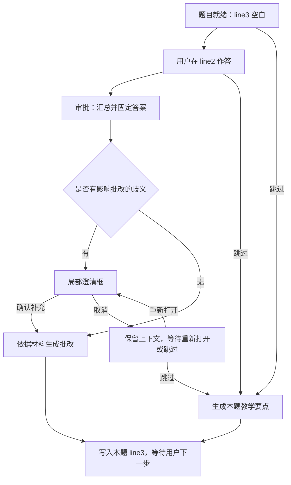

# 软件需求规格说明书（SRS）
# Codex 答题卡式教学交互扩展

| 文档属性 | 内容 |
|---|---|
| 文档标识 | CODEX-STUDY-UI-SRS |
| 版本 | 1.0 |
| 日期 | 2026-10-09 |
| 状态 | 初稿，可供需求评审与后续设计使用 |
| 需求来源 | 用户对话及《Codex 答题卡式 UI 与教学交互扩展需求》v2.2 |
| 首个应用场景 | 已安装的 `skill-study` 教学流程 |
| 本次交付 | SRS 文档；未实施、部署或验证客户端集成 |

## 1. 引言

### 1.1 目的

规定答题卡式教学交互的可观察行为、界面结构、状态变化、数据关联和验收条件，作为后续 UI 设计、集成验证、开发及测试的依据。

### 1.2 产品目标

用户在 Codex 学习过程中，直接在题目对应的局部输入区思考并作答，通过按钮触发批改或查看教学要点。题目、用户答案及模型输出保持空间关联，减少对全局聊天输入框和长消息流的依赖。

本产品定位为 Codex UI 与交互扩展，具备复用到其他 skill 的结构基础；首期围绕 `skill-study` 实现。原生消息流嵌入、专用面板或其他承载方式须经过集成验证后决定。

### 1.3 规范用语与来源等级

“必须”表示首期验收要求；“应”表示设计建议；“可”表示可选能力。`FR` 为功能需求，`UI` 为界面需求，`DR` 为数据需求，`NFR` 为非功能需求，`AC` 为验收场景。

用户已经明确的三层结构、输入与输出归属、审批与跳过行为、富内容表达以及局部询问框为需求基线。本文为使流程完整而补充的实施约定集中列于第 12 节，尚未代表用户逐项确认，也不等于技术路径已经选定。

### 1.4 术语

| 术语 | 定义 |
|---|---|
| 答题卡 | 一个问题及其作答、操作、模型输出的完整交互单元 |
| line | 按用途划分的内容层，可包含多行文字和多个内容块，不是文本行数 |
| line1 | 模型提供题目及背景的题目层 |
| line2 | 用户填写答案并进行操作的作答层 |
| line3 | 初始空白、等待模型写入生成内容的模型输出层 |
| 审批 | 用户确认提交答案并请求批改；与 Codex 执行权限审批无关 |
| 汇总答案 | 收集本次提交范围内的完整答案，保持内容及顺序，形成用于批改的快照；不自动指跨题批量提交 |
| 跳过 | 不提交答案评分，转为生成当前题的教学要点 |
| 澄清框 | 影响批改或教学的含义不明确时，按需出现的局部询问界面 |
| 材料依据 | 当前教学使用的课件、讲义或笔记及其可定位范围 |

## 2. 总体描述

### 2.1 用户与系统职责

| 角色或模块 | 职责 |
|---|---|
| 学习者 | 在 line2 输入答案，选择审批或跳过，必要时补充澄清信息 |
| 教学模型 | 提出问题，解释歧义，依据材料生成批改或教学要点 |
| UI | 展示内容层，接收输入与操作，将结果放回对应题目 |
| 会话与状态模块 | 绑定材料、题目、答案版本和请求，维护处理状态 |
| Codex 宿主或适配层 | 提供实际的显示、事件回传和模型调用连接 |

模块划分表示职责，不限定进程数量、语言、框架或部署方式。

### 2.2 首期范围

首期必须支持独立题卡、三层布局、多行文本作答、审批批改、跳过展示要点、富内容显示、局部澄清、多题状态隔离和失败重试。用户可在操作完成后停留阅读，不自动推进教学。

以下不作为首期必需功能：自动优化 skill、跨题批量审批、图片答案上传、表格或 UML 编辑器、重新作答及历史版本比较、多人协作、发布安装包和生产部署。预留结构不等于实施这些能力。

### 2.3 依赖与约束

必须存在能够展示交互组件并将用户事件回传的承载环境。仅输出 Markdown 或修改 `SKILL.md` 不满足真实输入区和按钮要求。

实际集成当前 Codex 桌面端的能力尚未验证。若只能提供外部配套界面，应明确报告其与“Codex 内部交互扩展”目标的差异，不能以外部页面替代而宣布原位集成已经完成。

材料来源和问题生成沿用教学上下文。缺少材料或页码时，不得虚构材料内容、定位信息和考试范围。

## 3. 外部界面要求

| 编号 | 要求 |
|---|---|
| UI-01 | 每题必须按 line1、line2、line3 的顺序展示三个可区分的内容区域，并标识题目归属。无需向用户显示内部字段名。 |
| UI-02 | line1 必须支持题干及背景内容；line2 必须提供初始空白的多行输入区和“审批”“跳过”按钮。 |
| UI-03 | line3 必须在题卡初始出现时保留可见的空白输出空间，无预置答案或批改。状态标签可置于区域边界，不能用预填结果代替空白。 |
| UI-04 | line2 接收用户输入；line3 接收模型输出，默认不供用户编辑。两个区域必须在视觉和交互上可区分。 |
| UI-05 | 内容层必须按内容自然增长，支持多段文本、图片和表格的组合。UML 必须能以渲染图或图片呈现，不能只显示无法理解的源码。 |
| UI-06 | 图片必须保持比例并提供放大查看方式；宽表格必须在所在区域内滚动；内容不能遮挡答案或操作按钮。 |
| UI-07 | 澄清框必须关联当前题目，支持选项及自由文字输入，不依赖全局聊天输入框，不固定占用第四层。 |
| UI-08 | 批改或教学内容必须出现在对应题目的 line3，不能仅追加到全局消息流。 |
| UI-09 | 每题必须明确显示处理中、待澄清或失败等状态；错误反馈必须靠近相关操作，并提供适用的恢复入口。 |

## 4. 功能需求

### 4.1 题目与答案

| 编号 | 要求 |
|---|---|
| FR-01 | 系统必须将教学问题组织为独立题卡，并绑定当前会话、材料、章节及可用的页码或小节。 |
| FR-02 | 用户必须能够在本题 line2 输入中文、英文或混合的多行答案，无需发送普通聊天消息。 |
| FR-03 | 系统必须保留当前会话中的草稿；操作其他题卡、提交、跳过或请求失败不得清空该草稿。 |
| FR-04 | 输入行为不得自动触发批改或填入 line3；审批必须由用户明确点击触发。 |

### 4.2 审批与模型输出

| 编号 | 要求 |
|---|---|
| FR-05 | 点击审批后，系统必须收集本次提交范围内的全部答案内容形成快照。汇总不得省略、改写用户答案或丢失内容块顺序。 |
| FR-06 | 系统必须校验答案非空。只有空白字符时，不发起批改，提示填写答案或选择跳过。 |
| FR-07 | 系统必须将题目、答案快照、材料上下文和已确认的澄清信息共同用于批改。 |
| FR-08 | 批改内容必须在审批触发后动态生成并写入 line3，不能通过展开预置答案模拟。 |
| FR-09 | 批改必须说明正确之处、缺漏或误解，并给出改进表达和可用的材料定位。无缺漏时明确说明，不强行制造错误。评分为可选，不能仅给分数。 |
| FR-10 | 材料不足以支持结论时，系统必须说明不足，不能将一般知识伪称为课件结论；课件外补充须明确标识。 |

### 4.3 跳过

| 编号 | 要求 |
|---|---|
| FR-11 | 点击跳过后，系统必须动态生成当前题对应的正常教学要点并写入 line3，不提交草稿评分。 |
| FR-12 | 教学要点必须涵盖当前题涉及的概念、关键术语及必要解释，可用图表或例子辅助理解。 |
| FR-13 | 跳过必须记录为独立状态，不记为答错、答对或已经掌握。 |

### 4.4 按需澄清

| 编号 | 要求 |
|---|---|
| FR-14 | 当存在影响批改或教学的实质歧义时，系统必须能够提出局部澄清问题；已能判断的答案不得被无必要的澄清打断。 |
| FR-15 | 澄清框必须说明需要确认的具体内容；有明确候选时提供选项，同时允许用户自由补充。 |
| FR-16 | 澄清必须由用户确认后提交，不能把预选状态当成用户回答。原答案与澄清信息必须分别保留并共同进入后续处理。 |
| FR-17 | 取消澄清必须保留答案和处理上下文，不替用户选择解释；允许重新打开澄清或改为跳过。 |
| FR-18 | 概念错误必须直接批改，不得通过带答案暗示的澄清引导修正后再评分。 |

### 4.5 状态隔离与恢复

| 编号 | 要求 |
|---|---|
| FR-19 | 每题必须独立关联输入、请求、状态及结果；操作一题不得覆盖其他题的数据。 |
| FR-20 | 系统必须阻止同题重复有效提交及审批、跳过冲突；旧请求或过期结果不得覆盖当前有效状态。 |
| FR-21 | 失败时必须保留答案、提交快照及已确认澄清，提供重试入口，不标记为成功完成。 |
| FR-22 | 审批、跳过和澄清完成不得自动切换下一题或下一教学部分。任何教学导航必须由独立的明确操作触发。 |

## 5. 业务规则

| 编号 | 规则 |
|---|---|
| BR-01 | 首期按每题独立提交处理；“汇总”包含本次提交中的多段内容，不推断为所有题统一审批。 |
| BR-02 | 同题处理期间只允许一个有效流程；line2 保留并显示答案，暂时不可改动，避免结果绑定不明。 |
| BR-03 | line3 在尚无生成结果时为空；处理中可显示状态，状态不等于批改内容。若采用流式输出，必须区分未完成片段与最终结果。 |
| BR-04 | 只有有效结果完成并归属校验通过后，才能记录为已批改或已展示要点。 |
| BR-05 | 取消澄清表示暂停当前流程，不清除答案，也不自动产生评分。 |
| BR-06 | 本轮已完成批改或跳过后，结果保留可读；重交与看过要点后再答不纳入首期必需能力。 |

## 6. 使用场景

| 场景 | 前置条件 | 主流程 | 结果 |
|---|---|---|---|
| UC-01 作答并批改 | 题卡及材料上下文已关联 | 用户输入 → 审批 → 校验并汇总 → 依据材料生成 → 写入 line3 | 原答案保留，显示对应批改 |
| UC-02 直接学习要点 | 题卡待作答或已有草稿 | 用户跳过 → 生成教学要点 → 写入 line3 | 草稿保留，记录跳过，不评分 |
| UC-03 澄清后批改 | 已审批且有影响判断的歧义 | 显示询问 → 用户选择或补充 → 确认 → 结合原答案生成 | line3 显示基于完整输入的结果 |
| UC-04 取消澄清 | 正在等待澄清 | 用户取消 → 保留待澄清状态 → 稍后重新打开或跳过 | 不猜测、不评分、不清空 |
| UC-05 失败重试 | 模型调用或结果接收失败 | 显示错误 → 用户重试 → 使用保留的上下文重新处理 | 不重复完成、不丢答案 |

## 7. 状态模型

| 状态 | 含义 | 允许的操作与转换 |
|---|---|---|
| READY | 题目已就绪，答案为空 | 输入 → DRAFT；跳过 → GENERATING_POINTS |
| DRAFT | 已有草稿 | 编辑 → DRAFT 或 READY；审批 → REVIEWING；跳过 → GENERATING_POINTS |
| REVIEWING | 正在检查或生成批改 | 有实质歧义 → NEEDS_CLARIFICATION；完成 → REVIEWED；失败 → FAILED |
| NEEDS_CLARIFICATION | 等待补充说明 | 确认 → REVIEWING；取消 → 保持本状态并关闭询问框；重新打开 → 显示询问框；跳过 → GENERATING_POINTS |
| GENERATING_POINTS | 正在生成教学要点 | 完成 → SKIPPED；失败 → FAILED |
| REVIEWED | 本轮批改完成 | 阅读结果；独立导航操作；不自动推进 |
| SKIPPED | 本题已跳过且要点生成完成 | 阅读要点；独立导航操作；不自动推进 |
| FAILED | 本次处理失败 | 重试 → 原处理流程；批改失败时可另选跳过 |

空答案审批保持 READY，不调用模型。FAILED 必须记录失败前的流程类型与有效快照，不能仅靠页面文字决定重试目标。待澄清取消后仍存在可重新打开的入口，不能进入无法继续的状态。

## 8. 数据要求

以下为逻辑数据要求，不限定数据库或具体 API 字段。

| 编号 | 数据 | 要求 |
|---|---|---|
| DR-01 | 题目身份 | 会话标识、题目标识、章节与教学分块归属必须可区分。 |
| DR-02 | 材料关联 | 保存材料标识及可获得的页码、小节或内容引用；生成期间保持材料版本一致。 |
| DR-03 | 内容层 | 按层及有序内容块表示，不能只保存三个不可扩展字符串；允许文本、图片、表格及图示引用。 |
| DR-04 | 用户答案 | 区分可编辑草稿与提交快照，保留答案版本和提交时刻。 |
| DR-05 | 澄清 | 保存问题、候选项、用户实际确认内容及所属答案版本。 |
| DR-06 | 模型结果 | 区分批改与教学要点，保存所属题目、答案版本（如适用）、完成状态及材料关联。 |
| DR-07 | 操作状态 | 记录操作标识、动作类型和状态版本，支持去重、冲突处理、重试与过期结果拒收。 |

本次会话内草稿保留为必需；应用关闭或刷新后的持久恢复为待决项，不在未经确认时承诺其实现。

## 9. 集成接口要求

| 编号 | 要求 |
|---|---|
| IF-01 | UI 与处理模块必须能交换题目生成、答案提交、跳过、澄清确认、重试及结果更新事件。 |
| IF-02 | 事件必须携带题目身份和操作关联信息；结果必须能定向更新对应 line3。 |
| IF-03 | 模型侧必须接收题目、材料、动作及相应答案或澄清上下文，输出可供内容层呈现的结果。 |
| IF-04 | 集成验证必须证明真实输入、按钮回传和局部结果更新；静态示意或仅改变网页文字不足以通过。 |

本文不强制选用 MCP、app-server 或修改客户端源码。技术选型须以实际宿主能力验证为依据；当前对话工具的存在不代表可以无限制复用于教学组件。

## 10. 非功能需求

| 编号 | 要求与验证方式 |
|---|---|
| NFR-01 可用性 | 核心作答、提交、跳过及澄清流程必须无需切回全局聊天框；通过端到端人工操作验证。 |
| NFR-02 内容可读性 | 在实现声明支持的最小与常用窗口尺寸下，输入、按钮、图表与文字不得重叠或被不可访问地截断。宽表格允许局部滚动。 |
| NFR-03 键盘操作 | 输入、选项及按钮必须可通过键盘访问，焦点可见；普通回车用于多行输入，不意外触发审批。 |
| NFR-04 反馈及时性 | 操作被接收后，应在 500 毫秒内显示本地处理状态；这是建议性能目标，模型完成时间不在此阈值内。 |
| NFR-05 完整性 | 重复事件、失序响应与请求失败不得造成跨题覆盖、草稿丢失或重复完成；通过故障注入与冲突用例验证。 |
| NFR-06 可扩展性 | 新增内容块类型或第四层时，应无需改变既有题目、答案和结果的身份关联。 |
| NFR-07 可验证性 | 测试必须能追踪一次操作关联的题目、输入版本、处理状态和结果，区分模型失败与界面失败。 |

## 11. 验收与追踪

以下是未来实现的验收条件，不表示本次已进行功能测试。

| 编号 | 验收操作与通过条件 | 主要需求 |
|---|---|---|
| AC-01 | 生成题卡，显示三层；line2、line3 初始为空；不存在预置批改。 | UI-01～04、FR-01 |
| AC-02 | 输入多行中英答案，操作其他题后返回，草稿与顺序完整；不自动批改。 | FR-02～04、NFR-01 |
| AC-03 | 审批包含多个段落的答案，处理端收到完整快照，结果写入本题 line3。 | FR-05、07～09、IF-01～04 |
| AC-04 | 空答案审批不请求模型，并提示填写或跳过。 | FR-06 |
| AC-05 | 已有草稿时跳过，显示本题教学要点，草稿保留，无评分或掌握判定。 | FR-11～13 |
| AC-06 | 材料不足的测试题不输出虚构页码或课件结论，明确说明依据不足。 | FR-10、DR-02 |
| AC-07 | 歧义答案触发本题澄清框，支持选项和自由输入；确认后的补充与原答案共同用于生成。 | UI-07、FR-14～16、DR-05 |
| AC-08 | 取消澄清后答案保留，可重新打开或跳过；未自动选择候选或评分。 | FR-17、BR-05 |
| AC-09 | 明确但错误的答案直接得到纠正，不通过暗示正确答案的询问改变评分依据。 | FR-18 |
| AC-10 | 两题分别操作，结果只更新本题，另一题草稿与状态不变。 | FR-19、UI-08、DR-01、04、06 |
| AC-11 | 模拟连点、冲突操作及失序结果，每题只接收有效流程，旧结果不覆盖。 | FR-20、DR-07、NFR-05 |
| AC-12 | 模拟请求失败后重试，原答案和澄清仍在，失败不算完成。 | FR-21、UI-09 |
| AC-13 | 批改或跳过完成后仍停留当前内容，没有自动推进章节或题目。 | FR-22 |
| AC-14 | 使用长题干、长反馈、UML 图及宽表格，在支持尺寸中检查可读性、放大和局部滚动。 | UI-05～06、DR-03、NFR-02 |
| AC-15 | 仅用键盘完成输入、审批、跳过和澄清；普通回车不提交。 | NFR-03 |
| AC-16 | 核验处理状态反馈及操作关联信息，模型耗时与 UI 响应分别记录。 | NFR-04、07 |
| AC-17 | 用样例增加内容块或可选第四层，原题的答案与结果关联仍有效。 | NFR-06 |

首期完成条件：所选集成路径通过 IF-04，全部强制验收场景通过；建议性能目标单独报告结果。静态原型通过视觉评审不等于模型与宿主集成通过。

## 12. 补充约定与待决项

### 12.1 为形成可实施规格采用的约定

首期按单题审批；模型处理期间锁定本题答案；line3 初始可见且空白；取消澄清后可重新打开；首期不要求重交；批改完成不自动导航。这些补充约定与已讨论流程一致，后续评审可调整。

### 12.2 待决事项

| 编号 | 事项 | 当前处理 | 对后续工作的影响 |
|---|---|---|---|
| TBD-01 | 当前 Codex 桌面端能否承载完整组件 | 未验证 | 必须在承诺原位集成前验证 |
| TBD-02 | 消息流内嵌还是专用面板 | 不限定位置，但必须保留题内作答与局部结果 | 影响详细 UI 设计 |
| TBD-03 | 审批按钮是否改名 | 当前保留“审批” | 只影响文案，语义已经确定 |
| TBD-04 | 刷新或关闭后的恢复 | 首期保证当前会话内保留 | 影响存储与生命周期设计 |
| TBD-05 | 独立导航的位置与规则 | 不允许单题操作自动推进 | 后续教学导航设计确定 |
| TBD-06 | 数值评分及评分尺度 | 首期必须解释批改，数值评分可选 | 不阻塞 UI 与交互实现 |
| TBD-07 | 支持窗口尺寸及性能目标 | 实现前声明支持尺寸，500 毫秒为建议值 | 用于形成可执行测试环境 |

以上待决项不妨碍使用本 SRS 进行界面原型设计和技术验证。本文不将未验证的产品能力写成既成事实。

## 13. 参考与版本记录

需求来源：[交互需求讨论稿 v2.2](./skill-study-interaction-feasibility.md)。教学规则依据：用户安装目录下的 `~/.codex/skills/skill-study/SKILL.md`，先前已只读检查。

讨论稿中包含的 OpenAI 官方链接作为技术调查入口，不作为已验证的当前客户端能力证明：

- [Plugin architecture](https://developers.openai.com/plugins/concepts/plugins)
- [MCP server and UI quickstart](https://developers.openai.com/plugins/build/app-quickstart)
- [Codex App Server](https://learn.chatgpt.com/docs/app-server)

| 版本 | 日期 | 变更 |
|---|---|---|
| 1.0 | 2026-10-09 | 根据讨论稿 v2.2 建立功能、界面、数据、状态、集成与验收基线；明确 line3 初始空白及动态生成语义。 |
